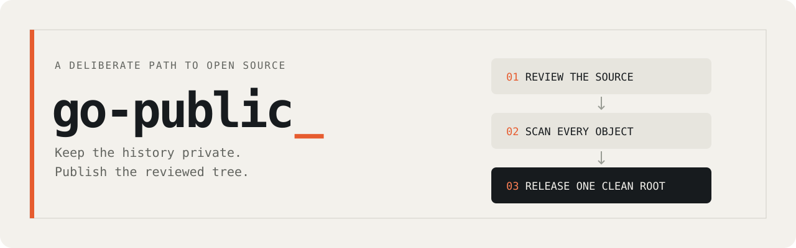

# go-public

<picture>
  <source media="(prefers-color-scheme: dark)" srcset="assets/banner-dark.svg">
  
</picture>

Keep the history private. Publish the reviewed tree.

A Claude Code skill for maintainers preparing a private project for GitHub. It guides cleanup, licensing,
security review, leak scanning, a fresh publication repository, stranger testing and GitHub safety settings.
The full procedure is in [SKILL.md](skills/go-public/SKILL.md).

## Install

Requires Git, signed-in GitHub CLI (`gh`), jq, Perl, Gitleaks, ExifTool and Node.js for the audit validators.
On macOS:

```bash
brew install gh jq gitleaks exiftool node
```

Clone this repository and install the skill into Claude Code:

```bash
git clone https://github.com/workflowsdiy/go-public.git
cd go-public
mkdir -p "$HOME/.claude/skills" "$HOME/.config/go-public"
ln -s "$PWD/skills/go-public" "$HOME/.claude/skills/go-public"
ln -s "$PWD/skills/security-audit" "$HOME/.claude/skills/security-audit"
cp -n skills/go-public/patterns.example.txt "$HOME/.config/go-public/patterns.txt"
```

Replace the example patterns with your own private identifiers before scanning: home paths, usernames,
internal hosts, private project names and personal emails. Keep the real file outside every repository.
For an existing installation, preserve that file. Optionally put your public commit identity (`Name <email>`)
in `~/.config/go-public/identity`.

Both skills are included. Keep the complete `skills/security-audit` directory together: its companion files,
report schema and validators are required by the release gate. For Codex, link the same two folders into its
skills directory instead:

```bash
mkdir -p "$HOME/.codex/skills"
ln -s "$PWD/skills/go-public" "$HOME/.codex/skills/go-public"
ln -s "$PWD/skills/security-audit" "$HOME/.codex/skills/security-audit"
```

The required audit and its pass criteria are in [step 5](skills/go-public/SKILL.md#5-reviews). A missing audit
installation blocks release. Reports stay outside the source and publication repositories.

## Use

Open the project you want to release in Claude Code and run:

```text
/go-public
```

The skill asks for the licence, public identity, destination and video preference, prepares a reviewed
publication candidate, then requires approval of the exact outward-facing actions before publishing.

The scanner also works directly from this checkout:

```bash
./skills/go-public/scan.sh /path/to/project --identity "Name <public@example.com>"
```

It returns `0` for clean, `1` for findings to resolve, and `2` when a scan could not finish. An incomplete scan
does not clear the release gate. Set `GO_PUBLIC_PATTERNS` to use a different external pattern file.

## What ships

| File | Purpose |
|---|---|
| [scan.sh](skills/go-public/scan.sh) | Checks available Git objects and refs, historical names and identities, UTF-16, archives, metadata, secrets and personal patterns in a temporary mirror |
| [settings.sh](skills/go-public/settings.sh) | Inventories non-Git exposure, applies public-repository safety settings, and checks those settings |
| [patterns.example.txt](skills/go-public/patterns.example.txt) | Starting point for your external private-pattern inventory |
| [scan-test.sh](test/scan-test.sh) | Throwaway-repository regressions for leak detection and failure paths; run with `bash test/scan-test.sh` |
| [security-audit](skills/security-audit/SKILL.md) | Complete audit skill, domain guidance, record schema, validators and their offline tests |

The audit validators use Node.js and its standard library. Run their regressions with:

```bash
node --test skills/security-audit/validate-findings.test.cjs skills/security-audit/validate-coverage-ledger.test.cjs
```

## Limits

Scans and reviews reduce risk; they do not prove that every secret or private detail is absent. Text inside
images, video or audio, encrypted archives, LFS payloads, submodule contents and outside-Git resources require
the manual checks described by the skill. A rewritten Git history cannot revoke credentials or other people's
copies. The workflow uses a fresh public repository and keeps the source history private.

Tests use existing environments; unavailable native checks remain explicitly unverified as described in
[the stranger-test procedure](skills/go-public/SKILL.md#8-stranger-test-before-publishing).

## Licence and tools

[MIT](LICENSE), copyright Joe LePage. The SVG banners are original assets included under the same licence.
The bundled audit skill is Joe LePage's adaptation of
[Cloudflare's security-audit-skill](https://github.com/cloudflare/security-audit-skill), based on upstream
[c1c8a8c](https://github.com/cloudflare/security-audit-skill/tree/c1c8a8c1471069fb0e188eeaff69b8e8db6564a8).
Its [full MIT notice](skills/security-audit/LICENSE), including Cloudflare's copyright, is preserved.
The bundled adaptation is based on snapshot `6a1ff7d48ddfa5a4f5d6e01f7965da58f341e60b` and maintained
in this distribution.
Git, GitHub CLI, jq, Perl, Gitleaks and ExifTool are installed separately; their source and binaries are not
bundled here.
