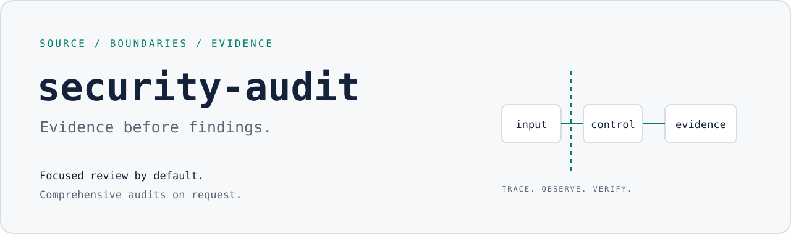

<picture>
  <source media="(prefers-color-scheme: dark)" srcset="assets/banner-dark.svg">
  
</picture>

# security-audit-skill

Focused security reviews for coding agents, with comprehensive audits when requested.

[](LICENSE)

A useful review follows untrusted input to a real consequence. This skill asks an agent to trace the source,
check the strongest existing controls, obtain a bounded observation, and independently verify candidate
findings. It separates demonstrated vulnerabilities from correctness bugs, hardening opportunities and facts
that still need validation.

This is agent guidance, not an automatic vulnerability scanner or a guarantee that a project is secure.
The bundled command-line tools validate audit records; they do not discover vulnerabilities.

## Install

Clone this distribution and enter its skills directory:

```sh
git clone https://github.com/workflowsdiy/go-public.git
cd go-public/skills
```

Point the agent at `security-audit/SKILL.md`, or place the folder in its configured skills directory.
Keep the companion files and validators together. No npm installation is needed.

From the same parent directory, try a review of the skill itself:

```text
Use ./security-audit/SKILL.md to review ./security-audit. Keep findings in chat.
```

## Choose the depth

**Focused review is the default**, even for an ordinary request to "audit" a small repository.
It uses source reading, the relevant domain guidance and one fresh verifier for candidate findings.
Results stay in chat; there is no ledger, schema output, coverage critic or audit report directory.
The result states its scope and limits.

**Comprehensive review is explicit.** Ask for full coverage or structured audit records:

```text
Use ./security-audit/SKILL.md to run a comprehensive security audit of ./security-audit,
using the standard profile. Keep all audit reports outside the repository.
```

That workflow records coverage, uses independent coverage critics and validates structured findings.
It offers quick, standard and deep profiles; their trade-offs are in [RECONNAISSANCE.md](RECONNAISSANCE.md).
A quick or scoped pass does not establish comprehensive coverage.

## Execution boundaries

Target-controlled code runs only with no external network, a safe empty allowlisted environment,
read-only source/toolchain, scratch-only writes, and low resource and wall-clock limits.
Use existing authorized test environments, local tools and dummy data. The agent does not build VM or sandbox
infrastructure for missing checks. Unavailable native checks remain explicitly unverified under the
[execution and reporting rules](SKILL.md#universal-execution-safety); missing controls still prevent execution.

The workflow does not authorize production probes, real credentials, dependency downloads, publication
or source fixes. Findings are confirmed only when the source path and a meaningful bounded observation hold.

## Offline checks

The bundled tools use Node.js and only its standard library. From the parent directory:

```sh
node --test security-audit/validate-findings.test.cjs security-audit/validate-coverage-ledger.test.cjs
```

The tests cover record contracts, safe input handling, path ownership and bounded parsing.
CLI validation refuses input when the platform cannot provide the required no-follow and nonblocking
file-open controls; unsupported test capabilities are reported as skips.

## Licence and credit

MIT; see [LICENSE](LICENSE).

This is an independent adaptation of [Cloudflare's security-audit-skill](https://github.com/cloudflare/security-audit-skill),
based on upstream [c1c8a8c](https://github.com/cloudflare/security-audit-skill/tree/c1c8a8c1471069fb0e188eeaff69b8e8db6564a8).
Cloudflare's copyright and MIT notice are preserved. Joe LePage's adaptations make focused review the
default and reduce orchestration for smaller targets. The SVG banners are original assets for this edition.
